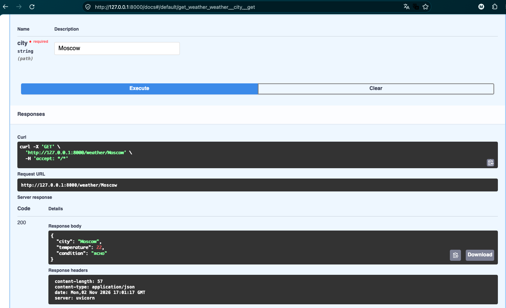
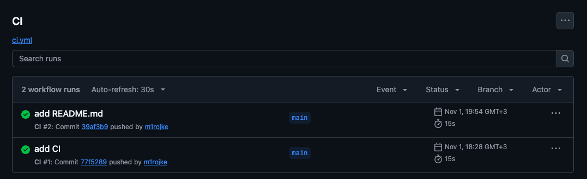
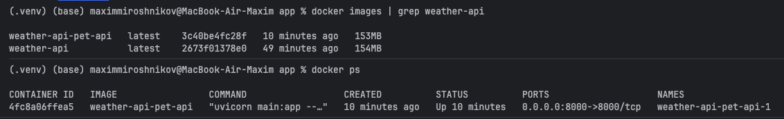

# Weather API Pet Project

Простой API для получения погоды по городу. Проект демонстрирует навыки контейнеризации, автоматизации сборки и подготовки к деплою.

## Стек
- Python + FastAPI
- Docker (Dockerfile, docker-compose)
- GitHub Actions (CI)

## Скриншоты
- Swagger UI - CI Status - Docker Info


## Как запустить локально
```bash
Вар 1:
- docker run -p 8000:8000 weather-api
- Затем открой http://localhost:8000/docs/

Вар 2:
- docker compose up -d #работа в фоновом режиме
- Затем открой http://localhost:8000/docs/
- docker compose down
